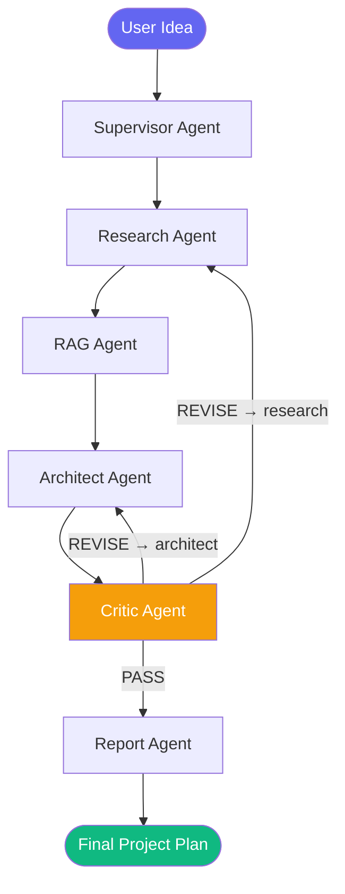

> **New React studio:** The primary interface now lives in `web/` (Next.js). The Python agents run behind `api.py` (FastAPI). The old `app.py` Streamlit interface remains only as a legacy reference.
>
> **Run locally (two terminals):**
> ```powershell
> .venv\Scripts\python.exe -m uvicorn api:api --host 127.0.0.1 --port 8000
> ```
> ```powershell
> cd web
> npm install
> npm run dev -- --hostname 127.0.0.1 --port 3001
> ```
> Open **http://127.0.0.1:3001**. Set `GOOGLE_API_KEY` in the root `.env` before building a plan. Use `.venv\Scripts\python.exe scripts\ingest_documents.py` once to prepare the knowledge base. The Next.js server proxies `/api/build` to the Python API; set `PLANNER_API_URL` if the API runs elsewhere.

<div align="center">

# 🤖 AI Project Builder

### Multi-Agent AI Project Planning System

*Describe your AI idea — six specialized agents collaboratively design your complete project plan.*

[](https://python.org)
[](https://langchain-ai.github.io/langgraph/)
[](https://aistudio.google.com)
[](https://streamlit.io)
[](https://trychroma.com)

---

**NTI Generative AI Internship — Graduation Project**

</div>

---

## 📋 Table of Contents

- [Overview](#-overview)
- [Multi-Agent Architecture](#-multi-agent-architecture)
- [Features](#-features)
- [Tech Stack](#-tech-stack)
- [Project Structure](#-project-structure)
- [Installation](#-installation)
- [Configuration](#-configuration)
- [Running the Application](#-running-the-application)
- [Knowledge Base Setup](#-knowledge-base-setup)
- [Example Output](#-example-output)
- [API Keys Guide](#-api-keys-guide)
- [Milestones](#-milestones)

---

## 🎯 Overview

**AI Project Builder** is a production-grade multi-agent system that accepts a natural language description of an AI project idea and autonomously generates a comprehensive technical project plan.

The system demonstrates real-world applications of:

| Concept | Implementation |
|---|---|
| **Multi-Agent Orchestration** | LangGraph `StateGraph` with 6 specialized agents |
| **Retrieval-Augmented Generation** | ChromaDB + sentence-transformers vector search |
| **Structured LLM Output** | Gemini function calling via Pydantic models |
| **Tool Calling** | Tavily web search + HuggingFace Datasets API |
| **Critic-in-the-Loop** | Automatic PASS/REVISE quality validation cycle |
| **Streaming UI** | Real-time agent progress in Streamlit |

---

## 🏗️ Multi-Agent Architecture



### Agent Responsibilities

| Agent | Role | Output |
|---|---|---|
| 🧠 **Supervisor** | Parse user idea → structured requirements | `Requirements` model |
| 🔍 **Research** | Web search + dataset discovery | `ResearchResult` model |
| 📚 **RAG** | Knowledge base retrieval + synthesis | Retrieved context string |
| 🏗️ **Architect** | Design system, dataset, model strategies | 3 architecture models |
| ⚖️ **Critic** | Validate plan quality → PASS or REVISE | `CriticResult` + routing |
| 📋 **Report** | Synthesize everything into final plan | `FinalProjectPlan` model |

### Graph State Flow

```
user_idea
    │
    ▼ Supervisor
requirements {}
    │
    ▼ Research Agent (Tavily + HuggingFace API)
research_results {}, sources []
    │
    ▼ RAG Agent (ChromaDB similarity search)
retrieved_context ""
    │
    ▼ Architect Agent (3 × structured LLM calls)
architecture {}, dataset_strategy {}, model_strategy {}
    │
    ▼ Critic Agent (quality gate)
critic_feedback {}, revision_count int, revision_target str
    │
    ├── PASS ──▶ Report Agent ──▶ final_report {}
    └── REVISE ─▶ [loops back up to max 2 times]
```

---

## ✨ Features

- **🤖 6 Specialized Agents** — each with a single, well-defined responsibility
- **🔄 Critic-in-the-Loop** — automatic revision cycle with configurable max attempts
- **📚 RAG Knowledge Base** — curated AI/ML documents for grounded recommendations
- **🌐 Live Web Search** — Tavily integration for real-time dataset and technique discovery
- **📊 Structured Outputs** — every agent output is validated by a Pydantic model
- **⚡ Streaming UI** — watch each agent complete in real time via Streamlit
- **🛡️ Graceful Degradation** — works without Tavily key (skips search), without OpenAI key (uses local embeddings)
- **📥 Downloadable Reports** — export full plan as JSON

---

## 🛠️ Tech Stack

### Core AI / ML
| Library | Version | Purpose |
|---|---|---|
| `langchain` | 1.2+ | Agent and chain abstractions |
| `langgraph` | 0.4+ | Multi-agent state graph orchestration |
| `langchain-google-genai` | 4.2+ | Gemini 2.0 Flash integration |
| `langchain-openai` | 1.6+ | OpenAI embeddings (optional) |
| `langchain-chroma` | Latest | ChromaDB vector store |
| `langchain-huggingface` | Latest | Local sentence-transformer embeddings |

### Tools & Search
| Library | Purpose |
|---|---|
| `tavily-python` | Web search API client |
| `httpx` | HuggingFace Datasets API calls |
| `sentence-transformers` | Local embedding fallback |
| `chromadb` | Persistent vector database |

### Application
| Library | Purpose |
|---|---|
| `streamlit` | Web UI with real-time streaming |
| `pydantic` | Structured output validation |
| `pydantic-settings` | `.env`-based configuration |

---

## 📁 Project Structure

```
AI_Project_Builder/
│
├── app.py                          # Streamlit UI (entry point)
├── requirements.txt                # All dependencies
├── .env.example                    # Environment variable template
│
├── app/
│   ├── agents/                     # Six specialized agent modules
│   │   ├── supervisor.py           # Requirements extraction
│   │   ├── research_agent.py       # Web + dataset search
│   │   ├── rag_agent.py            # Knowledge base retrieval
│   │   ├── architect_agent.py      # Architecture design (3 outputs)
│   │   ├── critic_agent.py         # Quality validation + routing
│   │   └── report_agent.py         # Final plan synthesis
│   │
│   ├── graph/
│   │   ├── state.py                # ProjectState TypedDict
│   │   └── workflow.py             # LangGraph StateGraph + run_pipeline()
│   │
│   ├── models/                     # Pydantic structured output models
│   │   ├── state_models.py         # Requirements
│   │   ├── research_models.py      # ResearchResult
│   │   ├── architecture_models.py  # ArchitectureResult, DatasetStrategy, ModelStrategy
│   │   ├── critic_models.py        # CriticResult
│   │   └── report_models.py        # FinalProjectPlan
│   │
│   ├── services/
│   │   ├── llm_service.py          # Gemini LLM abstraction (structured + plain)
│   │   └── search_service.py       # Tool orchestration for Research Agent
│   │
│   ├── tools/
│   │   ├── web_search.py           # Tavily web search tool
│   │   ├── dataset_search.py       # HuggingFace + curated dataset discovery
│   │   └── calculator.py           # AST-safe math evaluator
│   │
│   ├── rag/
│   │   ├── loader.py               # Document loader (MD, TXT, PDF)
│   │   ├── splitter.py             # RecursiveCharacterTextSplitter
│   │   ├── embeddings.py           # OpenAI / sentence-transformers factory
│   │   ├── vectorstore.py          # ChromaDB build + load
│   │   └── retriever.py            # Similarity search interface
│   │
│   ├── config/
│   │   └── settings.py             # Pydantic BaseSettings from .env
│   │
│   └── utils/
│       ├── logger.py               # Structured colored logging
│       ├── helpers.py              # Text sanitization utilities
│       └── validators.py           # Input validation
│
├── data/
│   ├── knowledge_base/             # Source documents for RAG ingestion
│   │   ├── computer_vision_best_practices.md
│   │   ├── nlp_best_practices.md
│   │   ├── rag_architecture_guide.md
│   │   ├── recommendation_systems_guide.md
│   │   └── ml_engineering_principles.md
│   └── chroma/                     # ChromaDB persistence (auto-created)
│
├── scripts/
│   └── ingest_documents.py         # CLI: embed knowledge base into ChromaDB
│
└── tests/
    ├── verify_imports.py
    ├── verify_milestone2.py        # Pydantic models
    ├── verify_milestone3.py        # LLM service + prompts
    ├── verify_milestone4.py        # Supervisor agent
    ├── verify_milestone5.py        # Tools + search
    ├── verify_milestone6.py        # Research agent
    ├── verify_milestone7.py        # Full RAG pipeline
    ├── verify_milestones8_10.py    # Architect, Critic, Report
    └── verify_milestone11.py       # LangGraph workflow
```

---

## 🚀 Installation

### Prerequisites

- Python 3.11+
- `pip` package manager
- A free [Google AI Studio API key](https://aistudio.google.com/app/apikey) (required)

### 1. Clone the repository

```bash
git clone https://github.com/your-username/AI_Project_Builder.git
cd AI_Project_Builder
```

### 2. Create and activate a virtual environment

```bash
# Windows
python -m venv .venv
.venv\Scripts\activate

# macOS / Linux
python -m venv .venv
source .venv/bin/activate
```

### 3. Install dependencies

```bash
pip install -r requirements.txt
```

---

## ⚙️ Configuration

### 1. Copy the environment template

```bash
cp .env.example .env
```

### 2. Edit `.env` and fill in your keys

```env
# ── Required ──────────────────────────────────────────────
GOOGLE_API_KEY=your_gemini_api_key_here

# ── Optional (improves quality) ───────────────────────────
OPENAI_API_KEY=your_openai_key_here        # For higher-quality embeddings
TAVILY_API_KEY=your_tavily_key_here        # For live web search

# ── LLM Settings (defaults are fine) ─────────────────────
LLM_MODEL=gemini-2.0-flash
LLM_TEMPERATURE=0.7
LLM_MAX_TOKENS=8192

# ── RAG Settings ──────────────────────────────────────────
RAG_TOP_K=5
CHUNK_SIZE=1000
CHUNK_OVERLAP=200
MAX_REVISIONS=2
```

> **Without `OPENAI_API_KEY`:** The system automatically falls back to local `sentence-transformers/all-MiniLM-L6-v2` embeddings — no quality loss for RAG, completely free.
>
> **Without `TAVILY_API_KEY`:** Web search is skipped; the Research Agent uses Gemini's training knowledge and HuggingFace Datasets API (still free).

---

## ▶️ Running the Application

### Step 1 — Ingest the knowledge base (first time only)

```bash
python scripts/ingest_documents.py
```

This embeds the 5 curated AI/ML knowledge documents into ChromaDB. Takes ~30 seconds on first run.

```
Step 1: Loading documents... Loaded 5 document(s)
Step 2: Splitting documents... Split into 33 chunks
Step 3: Embedding and storing in ChromaDB...
SUCCESS: 33 vectors stored in ChromaDB.
```

### Step 2 — Launch the Streamlit UI

```bash
streamlit run app.py
```

Open your browser at **http://localhost:8501**

### Alternative — Run via Python API

```python
from app.graph.workflow import run_pipeline

state = run_pipeline(
    "Build a computer vision system to detect manufacturing defects "
    "in real-time using YOLOv8 and FastAPI."
)

report = state["final_report"]
print(report["project_title"])
print(report["executive_summary"])
print(report["implementation_roadmap"])
```

### Streaming mode (for custom UIs)

```python
from app.graph.workflow import stream_pipeline

for agent_name, state_update in stream_pipeline("My project idea..."):
    print(f"[{agent_name}] completed")
    # Update your UI here
```

---

## 📚 Knowledge Base Setup

The RAG pipeline uses a curated knowledge base of 5 AI/ML guides:

| Document | Coverage |
|---|---|
| `computer_vision_best_practices.md` | CNNs, YOLO, transfer learning, augmentation, defect detection |
| `nlp_best_practices.md` | Transformers, BERT, fine-tuning, NER, sentiment analysis |
| `rag_architecture_guide.md` | Vector DBs, chunking strategies, retrieval, reranking |
| `recommendation_systems_guide.md` | Collaborative filtering, matrix factorization, neural CF |
| `ml_engineering_principles.md` | MLOps, data pipelines, experiment tracking, deployment |

**To add your own documents:**

1. Place `.md`, `.txt`, or `.pdf` files in `data/knowledge_base/`
2. Re-run `python scripts/ingest_documents.py --force`

---

---

## 🔄 Full Pipeline Walkthrough — Input to Output

This section traces a single project idea through all six agents, showing exactly what each agent receives, does, and produces.

---

### 📥 INPUT — User's Project Idea

```
"Build a real-time defect detection system for a manufacturing assembly
line. It should identify surface defects on metal parts with at least
95% accuracy and process images within 500ms using computer vision."
```

---

### 🔁 PIPELINE EXECUTION TRACE

---

#### 🧠 Step 1 — Supervisor Agent
> *Parses the raw idea into structured, validated requirements*

**What it does:**
- Calls Gemini with structured output (`Requirements` Pydantic model)
- Extracts: project type, domain, objectives, constraints, challenges
- Determines complexity and special flags (real-time, RAG needed)

**Output written to state:**
```json
{
  "project_title":      "Manufacturing Defect Detection System",
  "project_type":       "computer_vision",
  "target_domain":      "manufacturing",
  "objectives": [
    "Detect surface defects on metal parts with ≥95% accuracy",
    "Process each image within 500ms (real-time constraint)",
    "Minimize false positives to avoid production line interruptions"
  ],
  "constraints": [
    "Inference must run on edge hardware (no cloud dependency)",
    "Limited labeled defect images available (< 2,000)"
  ],
  "key_challenges": [
    "High class imbalance: defective parts are rare",
    "Real-time inference on embedded hardware",
    "Small labeled dataset requires transfer learning"
  ],
  "complexity":         "MEDIUM",
  "requires_real_time": true,
  "requires_rag":       false
}
```

---

#### 🔍 Step 2 — Research Agent
> *Searches the web and HuggingFace Datasets for relevant resources*

**What it does:**
- Calls `web_search` tool via Tavily for: *"YOLOv8 manufacturing defect detection 2024"*
- Calls `dataset_search` tool for: *"metal surface defect dataset computer vision"*
- Feeds results + requirements into Gemini → structured `ResearchResult`

**Output written to state:**
```json
{
  "summary": "Manufacturing defect detection is a mature CV domain. YOLOv8 and EfficientNet-based anomaly detectors dominate, with PatchCore offering strong zero-shot performance on the MVTec AD benchmark. Transfer learning from ImageNet is standard due to limited domain data.",
  "key_findings": [
    "PatchCore achieves 99.1% AUROC on MVTec AD without any defect labels",
    "YOLOv8n achieves <15ms inference at 640×640 on GPU, 40ms on CPU",
    "Data augmentation (elastic distortions, random erasing) critical for small datasets",
    "Semi-supervised learning can double effective dataset size"
  ],
  "dataset_hints": [
    "MVTec AD — 5,354 images, 15 industrial texture/object categories",
    "NEU Surface Defect Database — 1,800 images, 6 steel surface defect types",
    "DAGM 2007 — 10 industrial texture classes with weak labels"
  ],
  "model_hints": [
    "YOLOv8n for real-time detection (fastest, edge-friendly)",
    "PatchCore for anomaly detection (no defect labels needed)",
    "EfficientNet-B0 for classification with transfer learning"
  ],
  "sources": [
    "https://paperswithcode.com/task/anomaly-detection",
    "https://huggingface.co/datasets/mvtec-ad",
    "https://arxiv.org/abs/2207.07500"
  ]
}
```

---

#### 📚 Step 3 — RAG Agent
> *Retrieves relevant passages from the local ChromaDB knowledge base*

**What it does:**
- Builds query: `"computer vision manufacturing defect detection"`
- Runs `similarity_search(k=5)` against 33 embedded chunks
- Top retrieved passages come from `computer_vision_best_practices.md`
- Synthesizes into a concise context summary for the Architect

**Retrieved passages (top 2 shown):**
```
[Passage 1] Source: computer_vision_best_practices.md
Anomaly Detection / Defect Detection: Identify deviations from normal
patterns without requiring defect labels. Approaches: Autoencoders,
PatchCore, FastFlow, EfficientAD. Best dataset: MVTec AD (15 categories,
5000+ images). Key metric: AUROC, PRO score...

[Passage 2] Source: computer_vision_best_practices.md
For real-time CV applications requiring low latency: Use model
quantization (INT8 or FP16) to reduce latency by 2-4x. Export to ONNX
or TensorRT for optimized inference. YOLOv8n achieves ~1ms inference
on GPU for 640x640 images...
```

**Output written to state:**
```
retrieved_context: "The knowledge base confirms YOLOv8 is the leading
choice for real-time detection. PatchCore is optimal when defect labels
are scarce. ONNX Runtime + INT8 quantization is the recommended path
for edge deployment under 500ms. MVTec AD is the standard benchmark..."
```

---

#### 🏗️ Step 4 — Architect Agent
> *Designs three interconnected technical plans (3 × structured LLM calls)*

**What it does:**
- Makes **3 separate** Gemini calls, each producing a validated Pydantic model
- Uses requirements + research summary + retrieved context as shared context

**Call 1 → `ArchitectureResult`:**
```json
{
  "system_overview": "Edge-deployed CV pipeline: camera → preprocessing → YOLOv8n inference → alert system → operator dashboard.",
  "components": [
    { "name": "Image Capture Service",  "role": "RTSP/USB camera stream",    "technology": "OpenCV + GStreamer" },
    { "name": "Preprocessing Module",   "role": "Resize, normalize, buffer",  "technology": "NumPy + OpenCV" },
    { "name": "YOLOv8n Inference",      "role": "Defect detection <500ms",    "technology": "Ultralytics + ONNX Runtime" },
    { "name": "Alert Service",          "role": "Real-time operator alerts",  "technology": "FastAPI WebSocket" },
    { "name": "Dashboard",              "role": "Live defect visualization",  "technology": "Streamlit / Grafana" },
    { "name": "Result Logger",          "role": "Store detections + metrics", "technology": "SQLite + MLflow" }
  ],
  "tech_stack": ["Python 3.11", "PyTorch", "Ultralytics YOLOv8", "ONNX Runtime", "FastAPI", "OpenCV", "SQLite", "MLflow"],
  "deployment_approach": "ONNX INT8 quantized model on edge device (Jetson Nano or CPU server). FastAPI for alerts. No cloud dependency.",
  "estimated_complexity": "MEDIUM"
}
```

**Call 2 → `DatasetStrategy`:**
```json
{
  "recommended_datasets": ["MVTec AD", "NEU Surface Defect Database"],
  "data_collection_approach": "Start with MVTec AD texture categories. Supplement with 200+ real factory images. Use semi-supervised pseudo-labeling to expand dataset.",
  "preprocessing_steps": [
    "Resize all images to 640×640",
    "Normalize to ImageNet mean/std",
    "Apply Albumentations: HorizontalFlip, RandomRotate90, RandomBrightnessContrast",
    "Apply domain-specific: ElasticTransform, RandomErasing for defect simulation"
  ],
  "estimated_data_size": "~3,000 images post-augmentation (10× augmentation on 300 real images)",
  "augmentation_strategy": "10× augmentation using Albumentations. Focus on elastic distortion and random erasing to simulate surface defect diversity."
}
```

**Call 3 → `ModelStrategy`:**
```json
{
  "recommended_models": ["YOLOv8n", "PatchCore (fallback)"],
  "training_approach": "fine-tune",
  "training_approach_rationale": "YOLOv8n pretrained on COCO. Fine-tune only the detection head first (5 epochs), then unfreeze top 3 layers (10 epochs). PatchCore as zero-shot fallback.",
  "evaluation_metrics": ["mAP@0.5", "mAP@0.5:0.95", "Inference latency (ms)", "FPR@95%TPR"],
  "baseline_approach": "Classical OpenCV thresholding + blob detection for comparison",
  "hardware_requirements": "Training: GPU (RTX 3060 or Colab T4). Inference: CPU with ONNX Runtime or NVIDIA Jetson Nano."
}
```

---

#### ⚖️ Step 5 — Critic Agent
> *Validates the complete plan and decides: PASS or REVISE*

**What it does:**
- Reviews all 3 architecture outputs against the original requirements
- Checks: feasibility, completeness, metric alignment, real-time constraint coverage
- Produces structured `CriticResult` with status, severity, and revision target

**First evaluation → REVISE:**
```json
{
  "status":   "REVISE",
  "severity": "MEDIUM",
  "issues": [
    "Latency budget not explicitly validated: 500ms requirement needs breakdown (capture + preprocess + inference + alert)",
    "No fallback strategy if YOLOv8 misses rare defect classes"
  ],
  "recommendations": [
    "Add latency budget table: target <50ms inference, <100ms total pipeline",
    "Include PatchCore as anomaly baseline for unseen defect types"
  ],
  "revision_target": "architect",
  "reasoning": "Core plan is solid. Two medium-severity gaps need addressing before final report."
}
```

**Graph routes back to Architect Agent → revision_count = 1**

**Second evaluation → PASS:**
```json
{
  "status":   "PASS",
  "severity": "LOW",
  "issues":   [],
  "recommendations": ["Consider adding a model drift monitoring dashboard post-deployment"],
  "revision_target": "none",
  "reasoning": "All requirements addressed. Latency budget added. PatchCore fallback included. Plan is ready for final report."
}
```

---

#### 📋 Step 6 — Report Agent
> *Synthesizes everything into the final deliverable*

**What it does:**
- Pulls ALL state fields (requirements + research + context + architecture × 3 + critic feedback)
- Makes one final structured Gemini call → `FinalProjectPlan` Pydantic model
- Merges all sources, sets revision_count from state

---

### 📤 OUTPUT — Final Project Plan

```
━━━━━━━━━━━━━━━━━━━━━━━━━━━━━━━━━━━━━━━━━━━━━━━━━━━━━━━━━
  PROJECT:   Manufacturing Defect Detection System
  TIMELINE:  4 weeks (MVP)
  REVISIONS: 1 critic revision
  SOURCES:   8 references
━━━━━━━━━━━━━━━━━━━━━━━━━━━━━━━━━━━━━━━━━━━━━━━━━━━━━━━━━

EXECUTIVE SUMMARY
  An edge-deployed real-time computer vision pipeline using YOLOv8n
  to detect surface defects on metal manufacturing parts with ≥95%
  accuracy at <500ms end-to-end latency. Transfer-learned from COCO
  weights with MVTec AD + domain-specific augmentation. Deployable
  on CPU servers or NVIDIA Jetson Nano with no cloud dependency.

OBJECTIVES
  ✓ Detect surface defects with ≥95% accuracy (mAP@0.5)
  ✓ End-to-end latency < 500ms (50ms inference target)
  ✓ False positive rate < 5% to avoid line interruptions
  ✓ Edge deployment — no cloud dependency

ARCHITECTURE
  Camera (RTSP/USB)
    → OpenCV Preprocessing (640×640, normalize)
    → YOLOv8n ONNX Runtime (target: <50ms inference)
    → FastAPI Alert Service (WebSocket, <10ms)
    → Streamlit Dashboard (live defect overlays)
    → SQLite + MLflow Logger (metrics + model registry)

DATASET STRATEGY
  Primary:    MVTec AD — 5,354 images (texture categories)
  Secondary:  NEU Surface Defect DB — 1,800 steel defect images
  Collection: 200+ real factory images via domain capture
  Size:       ~3,000 images after 10× augmentation
  Split:      80% train / 10% validation / 10% test

MODEL STRATEGY
  Model:      YOLOv8n (fine-tuned from COCO weights)
  Fallback:   PatchCore (zero-shot anomaly detection)
  Baseline:   OpenCV thresholding + blob detection
  Training:   Phase 1 — freeze backbone, train head (5 epochs)
              Phase 2 — unfreeze top 3 layers (10 epochs)
  Target:     mAP@0.5 > 0.90  |  Latency < 50ms (ONNX INT8)
  Hardware:   Train: Colab T4 GPU  |  Deploy: Jetson Nano / CPU

IMPLEMENTATION ROADMAP
  Week 1 — Data Foundation
    1. Download MVTec AD + NEU datasets, run EDA
    2. Build Albumentations augmentation pipeline
    3. Set up MLflow experiment tracking

  Week 2 — Model Development
    4. Fine-tune YOLOv8n (Phase 1: head only)
    5. Fine-tune YOLOv8n (Phase 2: unfreeze layers)
    6. Implement PatchCore baseline for comparison
    7. Evaluate both: mAP, AUROC, latency benchmark

  Week 3 — System Integration
    8. Export YOLOv8n to ONNX with INT8 quantization
    9. Build FastAPI inference server + WebSocket alerts
   10. Build OpenCV capture → preprocessing → inference pipeline
   11. Add latency profiling: confirm <500ms end-to-end

  Week 4 — UI, Testing & Documentation
   12. Build Streamlit dashboard with live defect overlays
   13. Write integration tests + latency regression tests
   14. Document API, deployment guide, model card

RISKS & MITIGATIONS
  ⚠ Limited labeled defect data → Use PatchCore + pseudo-labeling
  ⚠ Class imbalance (few defects) → Focal loss + augmentation
  ⚠ Edge latency target → ONNX INT8 + TensorRT if needed
  ⚠ Domain gap (MVTec → real factory) → Collect 200+ real images

SUCCESS METRICS
  • mAP@0.5 ≥ 0.90 on held-out test set
  • End-to-end latency < 500ms (camera to alert)
  • False positive rate < 5% on good-part images
  • Baseline (OpenCV thresholding) comparison documented

REQUIRED SKILLS
  Python · PyTorch · OpenCV · YOLOv8 · FastAPI · ONNX Runtime
  MLflow · Albumentations · SQLite · Streamlit

SOURCES (8)
  1. https://paperswithcode.com/task/anomaly-detection
  2. https://huggingface.co/datasets/mvtec-ad
  3. https://arxiv.org/abs/2207.07500 (PatchCore paper)
  4. https://docs.ultralytics.com/models/yolov8/
  5. NEU Surface Defect Database — Northeastern University
  6. computer_vision_best_practices.md (knowledge base)
  7. ml_engineering_principles.md (knowledge base)
  8. https://onnxruntime.ai/docs/performance/quantization.html
━━━━━━━━━━━━━━━━━━━━━━━━━━━━━━━━━━━━━━━━━━━━━━━━━━━━━━━━━
```

---

### 📊 Pipeline Summary

| Stage | Agent | Time | State Fields Produced |
|---|---|---|---|
| 1 | Supervisor | ~3s | `requirements` |
| 2 | Research | ~8s | `research_results`, `sources` |
| 3 | RAG | ~2s | `retrieved_context` |
| 4 | Architect | ~15s | `architecture`, `dataset_strategy`, `model_strategy` |
| 5 | Critic (×2) | ~10s | `critic_feedback`, `revision_count=1` |
| 6 | Report | ~12s | `final_report` |
| **Total** | | **~50s** | **Complete project plan** |


---

## 🔑 API Keys Guide

| Key | Required | Free Tier | Get It |
|---|---|---|---|
| `GOOGLE_API_KEY` | ✅ Yes | Yes (15 RPM) | [aistudio.google.com](https://aistudio.google.com/app/apikey) |
| `OPENAI_API_KEY` | ❌ Optional | No (pay-per-use) | [platform.openai.com](https://platform.openai.com/api-keys) |
| `TAVILY_API_KEY` | ❌ Optional | Yes (1000 searches/month) | [app.tavily.com](https://app.tavily.com) |

---

## 📅 Milestones

| # | Milestone | Status |
|---|---|---|
| 1 | Foundation — config, logging, utils | ✅ |
| 2 | Pydantic models + LangGraph state | ✅ |
| 3 | LLM service + 6 prompt files | ✅ |
| 4 | Supervisor Agent | ✅ |
| 5 | Tools + Search Service | ✅ |
| 6 | Research Agent | ✅ |
| 7 | Full RAG Pipeline (ChromaDB) | ✅ |
| 8 | Architect Agent | ✅ |
| 9 | Critic Agent + conditional routing | ✅ |
| 10 | Report Agent | ✅ |
| 11 | LangGraph workflow assembly | ✅ |
| 12 | Streamlit UI | ✅ |

---

## 🎓 About This Project

This project was built as a graduation project for the **NTI (National Telecommunications Institute) Generative AI Internship Program**.

It demonstrates practical implementation of:
- Multi-agent AI systems using LangGraph
- Retrieval-Augmented Generation (RAG)
- Structured LLM outputs via Pydantic + function calling
- Tool calling with external APIs
- Streaming user interfaces

---

<div align="center">

Built with ❤️ using LangGraph · Gemini · ChromaDB · Streamlit

</div>
