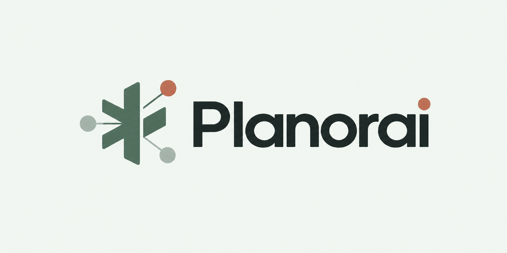

# Planorai

### AI project planning studio

Describe an AI project idea and receive a researched, reviewed technical plan.

---

## Current implementation

The **last** branch serves the React/Next.js studio as the primary interface. A Python FastAPI service streams progress from a six-agent LangGraph pipeline and returns a structured project plan. The UI includes a rotating 3D logo icon, live agent progress, a report view, and PDF/JSON export.

Internal agent trace objects are assembled in the Python backend and are not sent to the browser. The user-facing stream contains only progress metadata and, when complete, the final plan. JSON download is an export of that final plan, not the internal agent trace.

For the branch-specific architecture, API/event contracts, configuration, setup, troubleshooting, and development commands, see **[Branch last — technical documentation](docs/BRANCH_LAST.md)**.

## Quick start — Windows PowerShell

Prerequisites: Git, Python 3.11+, Node.js LTS with npm, and a Google AI Studio API key.

Clone the branch and install the Python dependencies:

~~~powershell
git clone -b last https://github.com/EmadAnwerNaguib465/Planorai.git
cd Planorai
py -3.11 -m venv .venv
.\.venv\Scripts\python.exe -m pip install -r requirements.txt
Copy-Item .env.example .env
notepad .env
~~~

Set GOOGLE_API_KEY in the root .env file. OpenAI and Tavily keys are optional. If you leave OPENAI_API_KEY empty, install the local embedding integration as described in the [branch documentation](docs/BRANCH_LAST.md#7-requirements). Then install the web dependencies:

~~~powershell
cd web
npm ci
~~~

Start the backend in one terminal from the repository root:

~~~powershell
.\.venv\Scripts\python.exe -m uvicorn api:api --host 127.0.0.1 --port 8000
~~~

Start the React interface in a second terminal from the web directory:

~~~powershell
npm run dev -- --hostname 127.0.0.1 --port 3000
~~~

Open [http://localhost:3000](http://localhost:3000/). Keep both terminals running. Full first-time setup, optional knowledge-base ingestion, API details, and troubleshooting are in the [branch documentation](docs/BRANCH_LAST.md).

## Repository map

- **web/** — Next.js App Router, React studio, report UI, rotating Three.js icon, and same-origin API proxy routes.
- **api.py** — FastAPI endpoints for health, streamed plan generation, and PDF export.
- **app/agents/** — Supervisor, Researcher, Knowledge Base, Architect, Reviewer, and Planner agents.
- **app/graph/** — shared pipeline state and LangGraph routing/revision loop.
- **app/models/** — validated request and report structures.
- **app/prompts/** — agent prompt templates.
- **app/rag/** — knowledge document loading, chunking, embeddings, and ChromaDB retrieval.
- **app/services/** — LLM, trace, report, search, and PDF services.
- **data/knowledge_base/** — curated AI/ML reference documents.
- **scripts/** — knowledge-base ingestion, evaluation, and report conversion utilities.
- **tests/** — Python test suite.

The root-level Streamlit entry point, app.py, is retained as a legacy interface; it is not the recommended way to launch the React application.

## License and project

NTI Generative AI Internship — Graduation Project. See [LICENSE](LICENSE).
